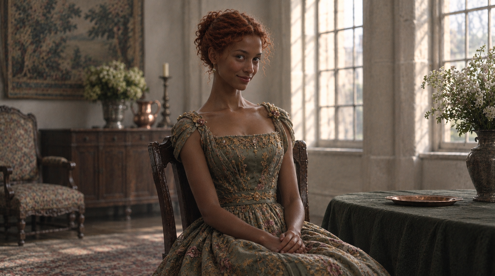

---
of:
  - codex/characters/karina.md
---



## How it was made

```json
{
  "provider": "handoff",
  "tool": "ChatGPT",
  "prompt": "A tall, poised young woman of eighteen with red hair worn up, dark skin and thin, fine features, in a light summer dress gathered at the shoulders that leaves her arms and the back of her neck bare. She sits upright and unhurried in a chair in a large, elegant guest room, her skirt arranged and her hands folded in her lap, her head tipped slightly with a shy, practiced dip of the chin, her bright eyes amused and calculating. A copper plate lies on a long table with a deep green cloth beside her; tall windows let in warm afternoon light. The mood is cool, charming and quietly scheming.\n\nStyle: Medium: A cinematic 35mm film photograph: natural textures, shallow depth of field, real materials. Palette: Muted, earthy colors: weathered stone, brown wool, aged wood, dull copper; pale stone and soft greens in the capital. Period and setting: A pre-industrial world: the school is old stone in the hills, the capital a white-stone city with early nineteenth-century dress. Water comes from pumps, wells and buckets; light from windows, lamps, candles and fires. Light: Natural light only: soft gray daylight indoors, low sun outdoors, lamp and firelight at night. Framing: Eye level, unhurried compositions; places shown whole enough to find your way around them.\n\nAvoid: text or lettering; taps, faucets or modern plumbing; electric lights; modern clothing or objects.",
  "references": [],
  "made": "2026-11-01T17:40:56.992Z"
}
```
