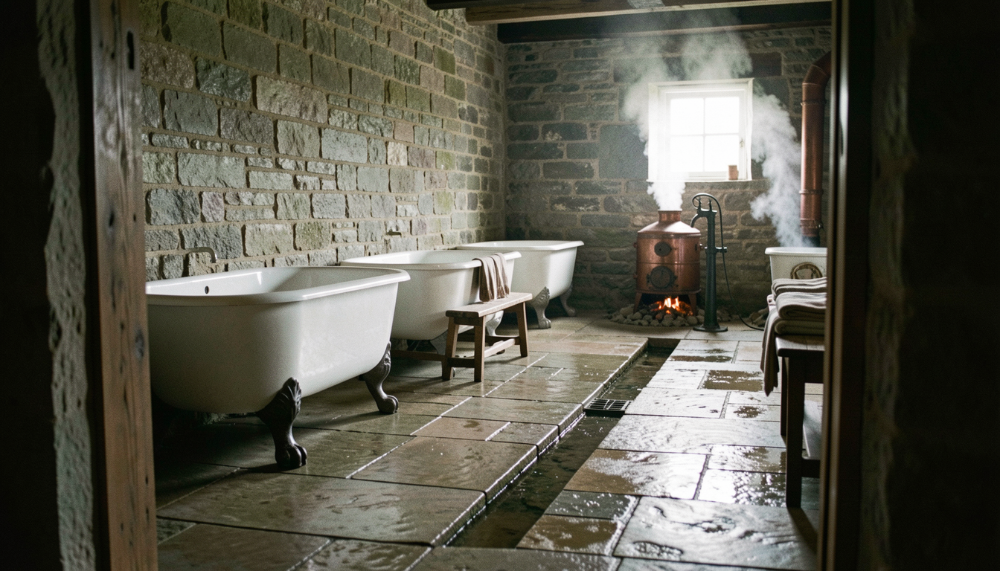

---
of:
  - codex/locations/the-washing-house.md
---



## How it was made

```json
{
  "provider": "comfyui",
  "model": "flux2-klein-9b",
  "seed": 1577782391,
  "count": 2,
  "size": "wide",
  "prompt": "The interior of a long, low washhouse built of damp gray stone, seen at eye level from the doorway. Wet flagstones slope toward a shallow drain running down the middle of the floor. Along one wall stands a row of old white tubs, glossy-glazed inside and resting on cast-iron feet shaped like animal paws, with a worn wooden bench beside them holding folded shirts. An iron hand pump stands at the near end, and in the far corner a dull copper boiler steams over a low banked fire. Soft gray daylight falls through a small window and catches the drifting steam; puddles shine on the stones. The mood is quiet, damp and workaday. Cinematic 35mm film photograph, shallow depth of field, muted earthy palette of weathered stone, brown wool and dull copper, natural light only; no taps, faucets or modern plumbing.\n\nStyle: Medium: A cinematic 35mm film photograph: natural textures, shallow depth of field, real materials. Palette: Muted, earthy colors: weathered stone, brown wool, aged wood, dull copper; pale stone and soft greens in the capital. Period and setting: A pre-industrial world: the school is old stone in the hills, the capital a white-stone city with early nineteenth-century dress. Water comes from pumps, wells and buckets; light from windows, lamps, candles and fires. Light: Natural light only: soft gray daylight indoors, low sun outdoors, lamp and firelight at night. Framing: Eye level, unhurried compositions; places shown whole enough to find your way around them.\n\nAvoid: text or lettering; taps, faucets or modern plumbing; electric lights; modern clothing or objects.\n\nWide establishing view of the place itself, empty and quiet, with nobody in it.",
  "references": [],
  "shot": {
    "location": "codex/locations/the-washing-house.md",
    "characters": [],
    "moment": {
      "text": "",
      "source": ""
    },
    "brief": "",
    "framing": {
      "shot": "wide",
      "time": "",
      "notes": ""
    }
  },
  "made": "2026-10-30T20:10:07.791Z"
}
```
