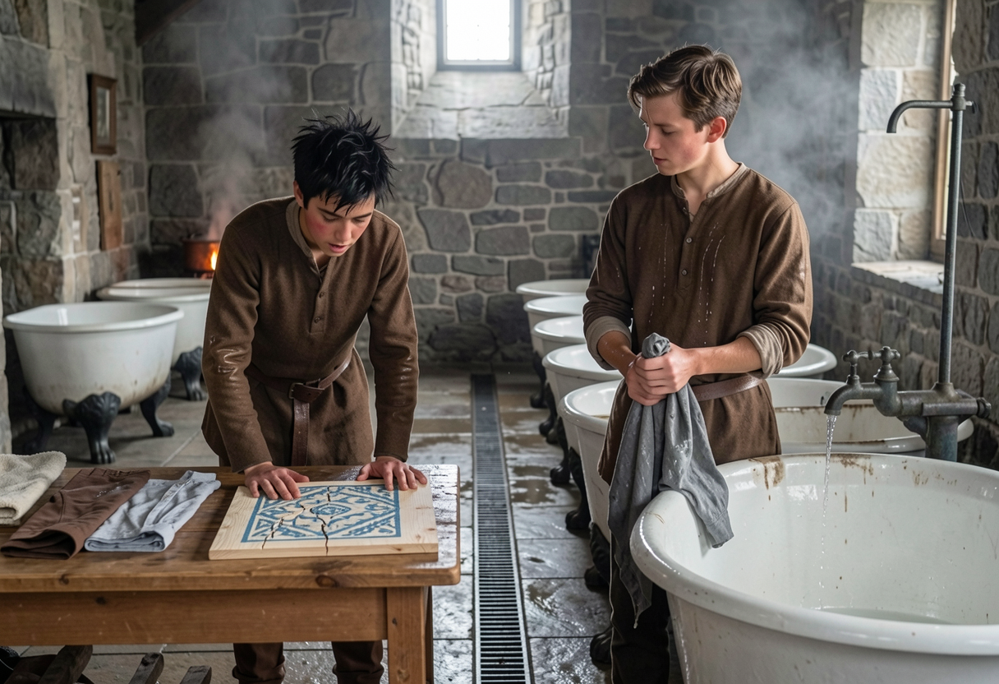

---
of:
  - codex/characters/tor.md
  - codex/characters/supporting/davie.md
  - codex/locations/the-washing-house.md
use: reference
variant: Davie
---




Davie in the washing house with Tor

## How it was made

```json
{
  "provider": "comfyui",
  "model": "flux2-klein-9b",
  "seed": 3936037498,
  "count": 2,
  "size": "landscape",
  "prompt": "Inside the washing house, a long low room of wet gray stone with a drain down the middle of the flagstone floor. Tor and Davie stand side by side at the same distance from the viewer, an arm's length apart: Davie a little taller and broader than Tor. Tor, on the left, leans over a plain wooden bench with both hands flat on the wood on either side of a small unsealed square of pale pine board, a hand across, painted with a blue pattern, the paint cracked along the grain; he studies it intently, lips moving as he mutters to himself. Beside the board his wrung-out washing lies damp in a row: two shirts, a pair of brown trousers, a towel. Davie, on the right, stands at his tub with his sleeves rolled to the elbow and wet splashes down his tunic, wringing a gray shirt and glancing sideways at Tor's board. Behind them a row of old white washing tubs, glazed inside, each on four cast-iron feet shaped like an animal’s paws, filled by bucket from a single old iron hand pump with a long handle at the near end of the room. In the far corner a copper steams over a banked fire.\n\nMedium shot. Time: morning, a little after the second bell, gray light from a high window. Eye level, square on to the two of them.\n\nTor: Small and slight: a young man of twenty who could pass for fifteen, a head shorter than the other students. Untidy black hair that sticks up on one side; a pale face that flushes red fast, often gray with tiredness under the eyes. He wears the school's brown: a wool tunic gone shiny at the elbows, brown trousers, boots and an old cut-down brown leather belt. Must match exactly: Black hair, untidy, often sticking up on one side.\n\nDavie: A sturdy young noble, younger than Tor but a little taller and broader. Neatly combed medium-brown hair. A broad, square-jawed Germanic face with a straight nose and fair skin. The school's brown wool tunic and brown trousers.\n\nThere are 2 distinct people in the picture: Tor and Davie. Each keeps their own face, hair and build as described; don't make them look alike.\n\nReference images, attached in this order. Keep each person and place consistent with their images:\nImage 1: Tor, full length. Use it only for Tor.\nImage 2: Tor’s face and hair only; ignore the coat and waistcoat, he wears the brown school tunic of image 1. Use it only for Tor.",
  "references": [
    {
      "path": "lookbook/tor-workshop.jpg",
      "commit": "117c3124bdbb03467a1c7d766a6bacb8f59f4181"
    },
    {
      "path": "lookbook/tor-capital-street.jpg",
      "commit": "117c3124bdbb03467a1c7d766a6bacb8f59f4181"
    }
  ],
  "shot": {
    "location": "codex/locations/the-washing-house.md",
    "characters": [
      {
        "path": "codex/characters/tor.md",
        "variant": ""
      },
      {
        "path": "codex/characters/supporting/davie.md",
        "variant": ""
      }
    ],
    "moment": {
      "text": "He put both hands flat on the bench on either side of it and looked at it. \"Right,\" he said, under his breath. \"Corners first. Don't rush it.\"",
      "source": "manuscript/01-chapter-one/02-the-laundry-scene.camera.md"
    },
    "brief": "Inside the washing house, a long low room of wet gray stone with a drain down the middle of the flagstone floor. Tor and Davie stand side by side at the same distance from the viewer, an arm's length apart: Davie a little taller and broader than Tor. Tor, on the left, leans over a plain wooden bench with both hands flat on the wood on either side of a small unsealed square of pale pine board, a hand across, painted with a blue pattern, the paint cracked along the grain; he studies it intently, lips moving as he mutters to himself. Beside the board his wrung-out washing lies damp in a row: two shirts, a pair of brown trousers, a towel. Davie, on the right, stands at his tub with his sleeves rolled to the elbow and wet splashes down his tunic, wringing a gray shirt and glancing sideways at Tor's board. Behind them a row of old white washing tubs, glazed inside, each on four cast-iron feet shaped like an animal’s paws, filled by bucket from a single old iron hand pump with a long handle at the near end of the room. In the far corner a copper steams over a banked fire.",
    "framing": {
      "shot": "medium",
      "time": "morning, a little after the second bell, gray light from a high window",
      "notes": "Eye level, square on to the two of them"
    }
  },
  "made": "2026-10-30T19:19:23.477Z"
}
```
