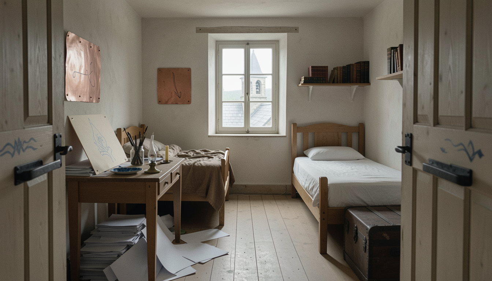

---
of:
  - codex/locations/tor-and-rolphs-room.md
---



## How it was made

```json
{
  "provider": "comfyui",
  "model": "flux2-klein-9b",
  "seed": 4114875198,
  "count": 2,
  "size": "wide",
  "prompt": "The interior of a narrow, plain student dormitory room on the top floor of an old stone school, seen from just inside the door. Plaster walls, bare wooden floorboards, a single small-paned window at the far end looking out over gray slate roofs toward a stone bell tower. Two plain wooden beds face each other along the side walls. The left half of the room is chaos: a wooden desk heaped with loose gray paper, more paper under it and on the floor, scraps of pale pine board with half-finished blue line patterns propped on the windowsill, a jar of brushes, a saucer crusted with dried blue paint, a brass-footed oil lamp, a candle stub; above the rumpled bed, a rough-cut copper plate the size of a book is nailed to the plaster with four nails, etched with a few simple lines and a downward hook. The right half is tidy: a neatly made bed, a short shelf of leather-bound books, and at the foot of the bed a small chest of dark wood bound in darker iron, with a smooth iron lock plate and no keyhole. On the inside of the plain oak door, a dark ash bar rests in two iron brackets under a simple pattern painted in blue. Soft gray morning light falls long across the floor. The mood is quiet, cramped, lived-in and warm. Cinematic 35mm film photograph, muted earthy palette, natural light only.\n\nStyle: Medium: A cinematic 35mm film photograph: natural textures, shallow depth of field, real materials. Palette: Muted, earthy colors: weathered stone, brown wool, aged wood, dull copper; pale stone and soft greens in the capital. Period and setting: A pre-industrial world: the school is old stone in the hills, the capital a white-stone city with early nineteenth-century dress. Water comes from pumps, wells and buckets; light from windows, lamps, candles and fires. Light: Natural light only: soft gray daylight indoors, low sun outdoors, lamp and firelight at night. Framing: Eye level, unhurried compositions; places shown whole enough to find your way around them.\n\nAvoid: text or lettering; taps, faucets or modern plumbing; electric lights; modern clothing or objects.\n\nWide establishing view of the place itself, empty and quiet, with nobody in it.",
  "references": [],
  "shot": {
    "location": "codex/locations/tor-and-rolphs-room.md",
    "characters": [],
    "moment": {
      "text": "",
      "source": ""
    },
    "brief": "",
    "framing": {
      "shot": "wide",
      "time": "",
      "notes": ""
    }
  },
  "made": "2026-10-30T20:12:00.638Z"
}
```
